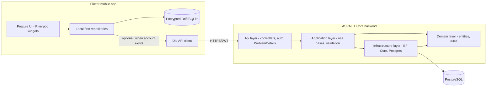

# Reclaim — Architecture

## Overview



Reclaim is **offline-first**: the Flutter app is fully usable with zero network access and
no account. An encrypted local database is the source of truth on-device. Creating an
account is optional and only adds backup, multi-device access and the (future)
accountability-partner feature. The backend exists from day one because account-based
sync, the shared blocklist, and future accountability features need a durable, multi-device
source of truth — but it is never a hard requirement to use the app.

## Repository layout

```
/mobile          Flutter app (package: reclaim_app)
/backend         ASP.NET Core solution (Reclaim.slnx)
  src/Reclaim.Domain            entities, value objects, domain rules, no dependencies
  src/Reclaim.Application       use cases (CQRS-lite handlers), DTOs, interfaces, validators
  src/Reclaim.Infrastructure     EF Core, repositories, auth/token services, external services
  src/Reclaim.Api               controllers, middleware, DI wiring, Program.cs
  tests/Reclaim.Application.Tests
  tests/Reclaim.Api.IntegrationTests
/infrastructure  docker-compose.yml (Postgres, pgAdmin)
/docs            product/architecture/database/API/blocking/security/privacy/roadmap docs
```

## Backend

**Stack:** ASP.NET Core 10 (LTS), EF Core + Npgsql, PostgreSQL, FluentValidation, Serilog, JWT
bearer auth + rotating refresh tokens, xUnit.

**Layering rules:**
- `Domain` has no dependency on any other project. Entities are POCOs with invariants
  enforced in constructors/methods, not anemic property bags.
- `Application` depends only on `Domain`. It defines repository/service *interfaces* and
  implements use cases (e.g. `SubmitAssessmentHandler`, `CreateGamblingEntryHandler`) plus
  FluentValidation validators for request DTOs.
- `Infrastructure` depends on `Application`+`Domain` and implements the interfaces
  (`ReclaimDbContext`, EF repositories, `IPasswordHasher`, `ITokenService`). Time comes from the BCL's `TimeProvider`, so tests use
  `FakeTimeProvider` rather than a custom clock interface.
- `Api` depends on all three, wires DI in `Program.cs`, exposes versioned controllers,
  global exception handling → `ProblemDetails`, request validation pipeline, rate limiting,
  Serilog request logging with sensitive-field redaction.

**Cross-cutting:**
- **Auth:** short-lived JWT access token (15 min) + rotating refresh token (30 days,
  hashed at rest, single-use — reuse revokes the whole chain).
- **API versioning:** all routes under `/api/v1/...` from day one.
- **Validation:** FluentValidation validators run in a global MVC action filter (`ValidationFilter`)
  before handlers.
- **Error handling:** a single exception-handling middleware maps domain/validation
  exceptions to RFC 7807 `ProblemDetails` responses; unhandled exceptions are logged with a
  correlation id and returned as a generic 500 (no internal detail leaked).
- **Logging:** Serilog structured logs to console (dev) / file (prod-ready sink
  configurable); journal/urge free-text content and credentials are never logged — only
  ids, types and timestamps (see `SECURITY.md`).

## Mobile

**Stack:** Flutter 3.x, Riverpod (+ code generation) for state/DI, `go_router` for
navigation, Drift (SQLite) + `sqlcipher_flutter_libs` for encrypted local storage, `dio` for
HTTP, `flutter_secure_storage` for tokens/keys, `local_auth` for biometric app lock.

**Why Riverpod:** compile-time-safe dependency injection without `BuildContext` coupling,
first-class support for async/stream providers (the dashboard and trackers are inherently
reactive over a local database), and providers are trivially overridable in tests — a good
fit for a local-first app where most state derives from a live database stream rather than
one-shot API calls.

**Why Drift over plain `sqflite`:** type-safe generated queries, reactive `Stream` queries
that plug directly into Riverpod `StreamProvider`s (so the dashboard updates the instant a
new entry/urge is recorded), and straightforward migrations as the schema grows.

**Feature-based folder structure:**
```
mobile/lib/
  core/
    theme/            design tokens, ColorScheme, TextTheme, component themes
    router/            go_router configuration, route guards (app lock, onboarding gate)
    network/           dio client, interceptors, api exceptions
    storage/           Drift database, secure storage wrappers, encryption key management
    widgets/           shared building blocks (cards, buttons, charts, empty/error states)
  features/
    auth/
    onboarding/
    assessment/
    dashboard/
    tracker/
    goals/
    urges/
    journal/            (Phase 2 — UI stub only in Phase 1)
    blocker/
    protection/
    support/            (Phase 2 — UI stub only in Phase 1)
    settings/
  app.dart, main.dart
```

Each feature follows `data/` (models, local + remote data sources, repository impl),
`domain/` (repository interface, entities where they differ from API/DB models), and
`presentation/` (screens, widgets, Riverpod providers/controllers).

**Local-first repository pattern:** every feature repository reads/writes Drift first and
exposes `Stream`s to the UI. If an account is present, mutating operations are additionally
queued for backend sync via a lightweight `SyncQueue` table, flushed by a background
`SyncService` when connectivity allows. Phase 1 ships a manual "Back up my data" action
that performs a one-shot bulk push; a real incremental/bidirectional sync engine with
conflict resolution is a `ROADMAP.md` item.

## Testing strategy

- **Backend:** xUnit unit tests for domain rules and application handlers (mocked
  interfaces); integration tests spin up a real Postgres via Testcontainers and exercise
  controllers through `WebApplicationFactory`.
- **Mobile:** `flutter_test` widget/unit tests per feature, Riverpod providers tested by
  overriding dependencies; Drift repositories tested against an in-memory SQLite instance.

## Build & CI expectations

Every implementation pass ends with `dotnet build && dotnet test` and
`flutter analyze && flutter test` passing before moving on — the repository is never
knowingly left in a broken state.
