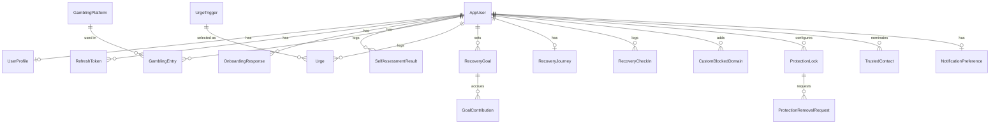

# Reclaim — Database Design

PostgreSQL via EF Core. All primary keys are `uuid` (generated client- or server-side).
All tables have `CreatedAtUtc`/`UpdatedAtUtc`. Soft delete (`DeletedAtUtc` nullable) is used
**only on `AppUser`**, to support the account-deletion grace period described in
`SECURITY.md`/`PRIVACY.md`; every other table hard-deletes, to minimise how long sensitive
data is retained once a user asks for it to be removed.

## Entity-relationship overview

## Tables

### AppUser
The account, only created if the user opts in. `Id (uuid, pk)`, `Email (unique, nullable
until verified? see below)`, `PasswordHash`, `PasswordHashAlgorithm`, `EmailVerifiedAtUtc`,
`DeletedAtUtc` (soft-delete grace period), `CreatedAtUtc`, `UpdatedAtUtc`.

### RefreshToken
`Id`, `AppUserId (fk)`, `FamilyId` (shared by every token rotated from one login),
`TokenHash` (never store the raw token), `ExpiresAtUtc`, `RevokedAtUtc`,
`ReplacedByTokenHash`, `CreatedAtUtc`, `UpdatedAtUtc`. Reuse of a revoked token revokes every
token in its family (theft detection) without signing the user out of other devices.

### UserProfile
`Id`, `AppUserId (fk, nullable — a purely local/anonymous profile has no AppUserId)`,
`LocalProfileId (uuid, always set — the on-device identifier)`, `DisplayName (optional)`,
`RecoveryGoalType (Stop | Reduce)`, `QuitOrReductionStartDateUtc`, `CreatedAtUtc`,
`UpdatedAtUtc`.
*Note:* on the backend, `UserProfile` rows only exist for accounts that synced. The mobile
app's local Drift schema mirrors this table for anonymous users; there is no backend row
until the user creates an account and syncs.

### OnboardingResponse
`Id`, `UserProfileId (fk)`, `GamblingTypes (text[])`, `FrequencyBand`, `ApproxMonthlySpend
(decimal, nullable)`, `Triggers (text[])`, `Goal (Stop | Reduce)`, `MoneyGoalPreference
(free text, optional, encrypted at rest)`, `CreatedAtUtc`, `UpdatedAtUtc`. Enum lists are stored
as `text[]` of enum names.

### SelfAssessmentResult
`Id`, `UserProfileId (fk)`, `QuestionnaireVersion (int)`, `Answers (jsonb, question id →
0-3)`, `Score (int)`, `RiskLevel (Low | Increasing | High)`, `CreatedAtUtc`, `UpdatedAtUtc`. Historical rows are kept (never overwritten) so
progress over time can eventually be shown.

### GamblingEntry
`Id`, `UserProfileId (fk)`, `EntryType (Deposit | Withdrawal | Win | Loss)`,
`Amount (decimal(12,2))`, `OccurredAtUtc (date the user reports, not necessarily now)`,
`GamblingPlatformId (fk, nullable)`, `GamblingType (SportsBetting | Casino | Slots |
CrashGame | Lottery | Other)`, `Notes (text, nullable, encrypted at rest — see SECURITY.md)`,
`CreatedAtUtc`, `UpdatedAtUtc`. Indexed on `(UserProfileId, OccurredAtUtc)`.

### GamblingPlatform
Lookup of platform *names* the user has typed (e.g. "Betway", "Hollywoodbets") — **not** a
directory of gambling sites, purely so the tracker can autocomplete/group by platform.
`Id`, `Name`, `NormalizedName` (upper-cased, trimmed), `CreatedByUserProfileId (fk,
nullable — null for common seeded names)`, `CreatedAtUtc`, `UpdatedAtUtc`. Unique on
`(CreatedByUserProfileId, NormalizedName)`. Nothing is seeded yet.

### Urge
`Id`, `UserProfileId (fk)`, `UrgeTriggerId (fk)`, `Intensity (1-5, nullable)`,
`CoolingOffMinutesSelected (10|20|30|60)`, `StartedAtUtc`, `ResolvedAtUtc (nullable)`,
`Outcome (Passed | Gambled | Abandoned, nullable until resolved)`, `Notes (text,
nullable)`, `CreatedAtUtc`.

### UrgeTrigger
Lookup: Stress, Boredom, Payday, TryingToRecoverLosses, Alcohol, FriendsGambling,
Loneliness, Excitement, FinancialPressure, Other. `Id`, `Code`, `Label`.

### RecoveryJourney
One per profile. `Id`, `UserProfileId (fk, unique)`, `QuitOrReductionStartDateUtc`,
`CurrentStreakStartUtc`, `LongestStreakDays (int)`, `LastRelapseAtUtc (nullable)`,
`UpdatedAtUtc`. Streak/longest-streak values are recomputed from `GamblingEntry`/`Urge`
outcome data by an application-layer service rather than trusted as free-standing input.

### RecoveryCheckIn
Lightweight daily/periodic check-in record (mood, one-line note). `Id`, `UserProfileId
(fk)`, `CheckInDateUtc`, `Mood (1-5, nullable)`, `Note (text, nullable)`, `CreatedAtUtc`.

### RecoveryGoal
`Id`, `UserProfileId (fk)`, `Name`, `TargetAmount (decimal)`, `Category (EmergencyFund |
Car | HouseDeposit | Debt | Holiday | Education | Family | Savings | Custom)`,
`TargetDateUtc (nullable)`, `CreatedAtUtc`, `UpdatedAtUtc`.

### GoalContribution
Manual or automatic (estimated-savings-derived) contribution toward a goal. `Id`,
`RecoveryGoalId (fk)`, `Amount (decimal)`, `Source (Manual | EstimatedSavings)`,
`OccurredAtUtc`, `CreatedAtUtc`.

### BlocklistDomain
Backend-managed, global gambling-domain blocklist, versioned so mobile clients can
incrementally sync. `Id`, `Domain`, `Category (SportsBetting | Casino | Slots |
CrashGame | Lottery | Other)`, `Source (Curated | UserSubmitted)`, `IsActive (bool)`,
`CreatedAtUtc`, `UpdatedAtUtc`. Indexed on `Domain` (unique) and `UpdatedAtUtc` (for
"give me everything changed since X" sync).

### CustomBlockedDomain
User-added domain, local-first (Drift) with optional sync. `Id`, `UserProfileId (fk)`,
`Domain`, `AddedAtUtc`, `Removable (bool — false while a ProtectionLock is active, per the
Protection Lock feature)`.

### ProtectionLock
`Id`, `UserProfileId (fk)`, `DurationDays (1|7|30|90|180|365)`, `StartedAtUtc`,
`ExpiresAtUtc`, `Status (Active | Expired | RemovalRequested)`, `CreatedAtUtc`.

### ProtectionRemovalRequest
`Id`, `ProtectionLockId (fk)`, `RequestedAtUtc`, `CoolingOffExpiresAtUtc` (always
`RequestedAtUtc + 24h` for MVP), `Status (Pending | Cancelled | Completed)`,
`ResolvedAtUtc (nullable)`.

### TrustedContact
Opt-in accountability partner. `Id`, `UserProfileId (fk)`, `Name`, `ContactMethod (Email |
Phone, stored encrypted)`, `PinHash (nullable)`, `SharesDetailedHistory (bool, default
false)`, `Status (Invited | Active | Revoked)`, `CreatedAtUtc`.

### NotificationPreference
`Id`, `UserProfileId (fk, unique)`, `MilestonesEnabled`, `DailyCheckInEnabled`,
`GoalProgressEnabled`, `ProtectionStatusEnabled`, `CoolingOffRemindersEnabled` (all bool,
default true), `DiscreetWording (bool, default true)`.

### SupportResource
Backend-managed, editable without an app release. `Id`, `Name`, `Category (Gambling
Support | Counselling | SelfExclusion | FinancialCounselling | Emergency)`, `Description`,
`PhoneNumber (nullable)`, `Website (nullable)`, `Region (default "South Africa")`,
`IsVerified (bool)`, `CreatedAtUtc`, `UpdatedAtUtc`. Phase 1 ships the table and endpoint
empty/seeded with clearly-labelled placeholder entries pending verification — see
`PRODUCT.md`/`ROADMAP.md` for why we will not hardcode unverified numbers.

### AuditLog
Security-relevant events only (login, password change, account deletion request, refresh
token reuse detected, protection-lock removal request/cancel). `Id`, `AppUserId
(nullable)`, `EventType`, `Metadata (jsonb, no sensitive content)`, `IpAddressHash`,
`CreatedAtUtc`.

## Notes on the local (mobile) schema

The Drift schema on-device mirrors `UserProfile`, `OnboardingResponse`,
`SelfAssessmentResult`, `GamblingEntry`, `GamblingPlatform`, `Urge`, `RecoveryJourney`,
`RecoveryGoal`, `GoalContribution`, `CustomBlockedDomain`, `ProtectionLock`,
`ProtectionRemovalRequest`, `NotificationPreference` (plus a `SyncQueue` table). It is the
source of truth for anonymous users and is encrypted at rest (see `SECURITY.md`).
